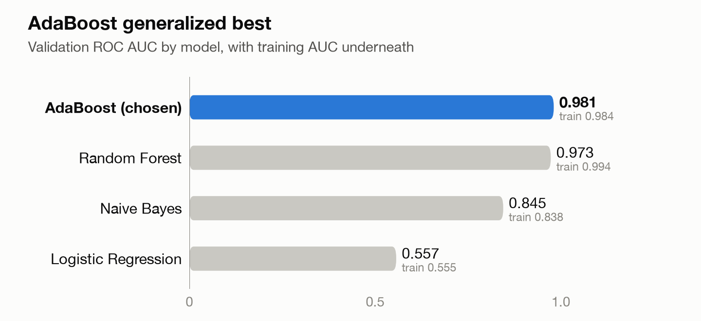
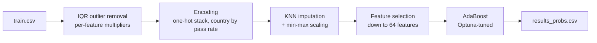

# ML-Interview-Pass-Prediction

I built a model that predicts whether someone will pass a software engineering interview. It took first place in my university Machine Learning course competition, with an AUC of 0.984.

<picture>
  <source media="(prefers-color-scheme: dark)" srcset="docs/model_comparison_dark.png">
  
</picture>

## The problem

Given about 55,000 labelled candidates with 15 mixed features (experience, salary history, education, country, tech stack, plus anonymized columns A to D), output a pass probability for 18,000 unseen candidates. The data has missing values, outliers and two high-cardinality categorical columns, and the competition was ranked on ROC AUC.

## What I built

One notebook, `main.ipynb`, that goes from raw CSV to submitted probabilities: exploration, cleaning, feature engineering, four model families compared, hyperparameter search, and a final pipeline cell that reproduces the submission on its own.

| Model | Train AUC | Validation AUC |
|---|---|---|
| AdaBoost on decision trees (chosen) | 0.984 | 0.981 |
| Random Forest | 0.994 | 0.973 |
| Gaussian Naive Bayes | 0.838 | 0.845 |
| Logistic Regression | 0.555 | 0.557 |

## Pipeline



## Design decisions

- AdaBoost over Random Forest. The forest scored higher on training data but had a train to validation gap of 0.021, against 0.003 for AdaBoost. I picked the model that generalized, not the one that memorized.
- `stack_experience` is a free list of technologies, so it is one-hot encoded per technology. `country` has too many values for that, so each country is replaced by its pass rate.
- Missing values are filled with KNN imputation, which uses similar candidates and keeps relationships between features that a column mean would flatten.
- Outliers are removed with the IQR rule, with a separate multiplier per feature, because the columns are distributed too differently for one cutoff to suit all of them.
- Feature selection cut the encoded set to 64 features. Validation AUC went up and training time went down.
- `B` is highly correlated with years of experience, and the textbook move is to drop it. Dropping it lowered validation AUC, so it stayed.
- Optuna instead of a grid for the final search over 8 AdaBoost and tree parameters. It landed on 3,579 shallow trees (depth 6) with a learning rate of 0.007.

## Files

| File | What it is |
|---|---|
| `main.ipynb` | The full analysis, with outputs |
| `report_paper.pdf` | The written report |
| `results_probs.csv` | Submitted pass probabilities for the 18,000 test candidates |

## Running it

```bash
python3 -m venv .venv && .venv/bin/pip install jupyter pandas numpy scikit-learn optuna matplotlib seaborn
```

```bash
.venv/bin/jupyter notebook main.ipynb
```

The course dataset (`train.csv`, `test.csv`) is not in the repo, so the notebook can be read with its saved outputs but not re-run without it. Two cells, the feature selection and the Optuna search, take hours. Their results are hardcoded in the cells that follow, and the last cell (FINAL PIPELINE) is enough to produce the predictions.
